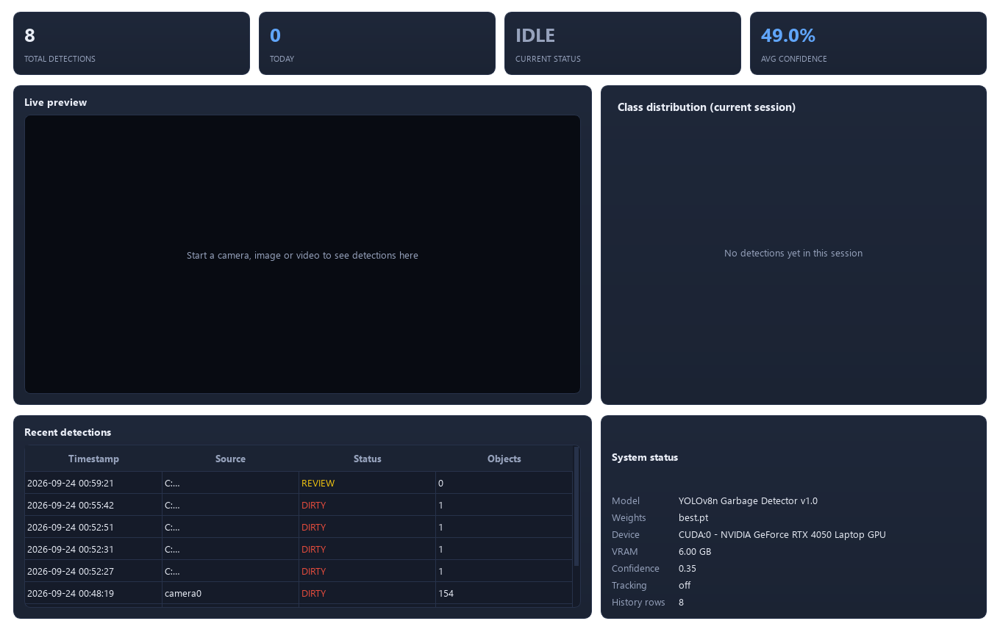
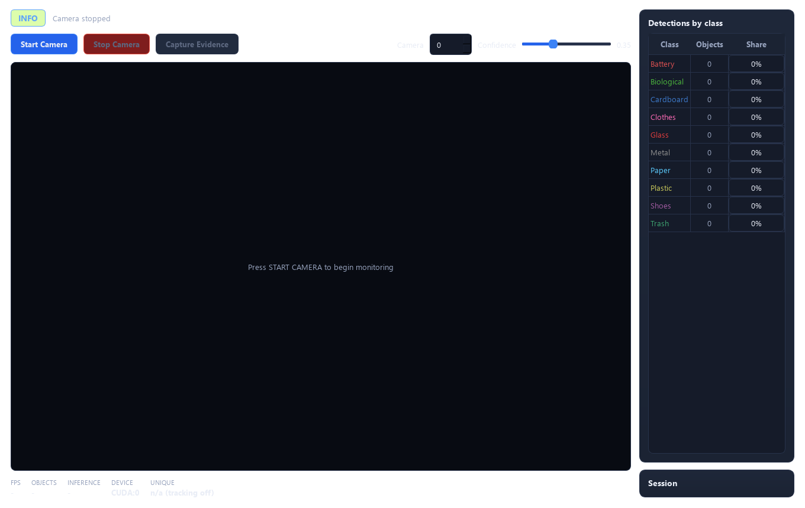
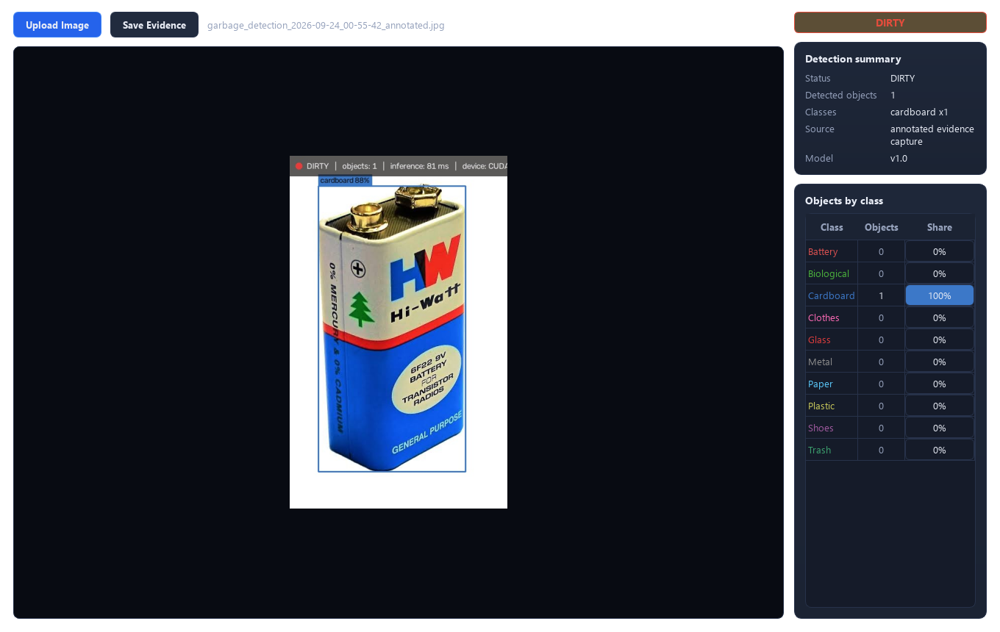
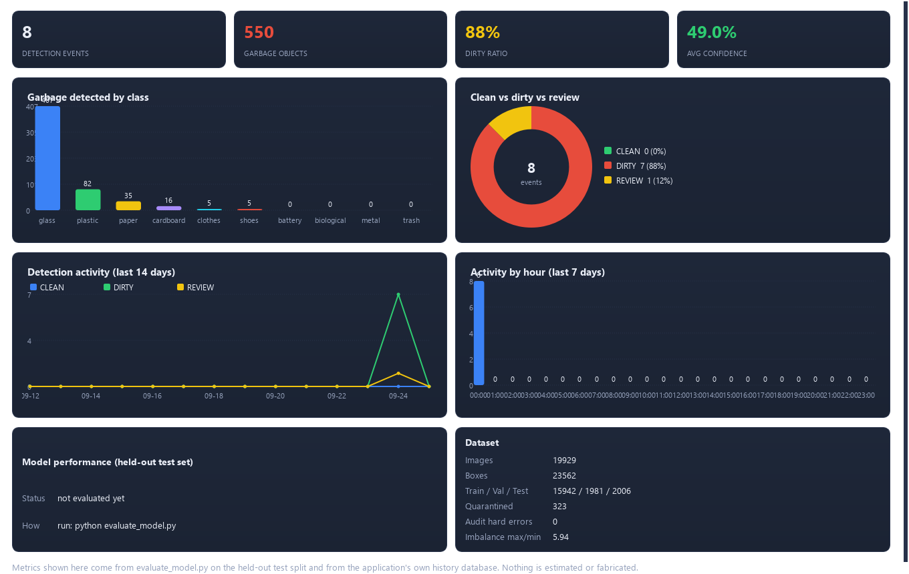
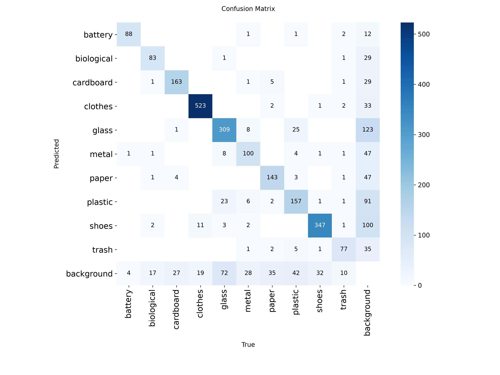

# Smart Garbage Detection System

An end-to-end AI waste-detection system built with **Python, YOLOv8, PyTorch and OpenCV**, wrapped in a professional multi-page **PySide6 (Qt)** dashboard. It detects and counts 10 classes of litter from a live webcam, images, or video files; derives a scene status (**CLEAN / DIRTY / REVIEW**); records every event to a SQLite history; stores tamper-evident evidence bundles; and raises throttled alerts when accumulation crosses a threshold.

Final-year project (B.Tech, AIML) — developed and benchmarked on an NVIDIA RTX 4050 Laptop (CUDA).

---

## Screenshots

| Dashboard | Live camera detection |
|---|---|
|  |  |

| Image analysis | Analytics |
|---|---|
|  |  |

---

## Results (held-out TEST split)

| Metric | Value |
|---|---|
| mAP@50 | **0.843** |
| mAP@50-95 | **0.686** |
| Inference speed | ~34 FPS on CUDA (RTX 4050 Laptop) |
| Model size | 3.01M parameters (YOLOv8n) |



Every number is measured on the held-out **test** split by `evaluate_model.py` — never on training data, never fabricated.

---

## Key features

- **Three input modes** — live webcam, single image, video file — from both a CLI and an 8-page GUI (Dashboard, Live Camera, Image, Video, History, Analytics, Settings, About)
- **Derived scene status** — CLEAN / DIRTY / REVIEW with colour-coded boxes, HUD overlay, and a schema guard that refuses to load any model not trained on this project's exact 10-class schema
- **Unique-object counting** via optional ByteTrack tracking
- **Evidence bundles** — original frame + annotated frame + JSON metadata, written with a never-overwrite guarantee
- **SQLite history** (schema v2, with migration) — filters, aggregates, CSV export, thread-safe
- **Analytics** — class distribution, daily/hourly activity, model and dataset summaries rendered with custom QPainter charts (no QtCharts dependency)
- **Throttled alerts** — configurable count threshold and cooldown
- **16-check self-test** that runs without a trained model

---

## Data integrity

The highest priority of this project is **correct data + correct annotations**.

| Fact | Value |
|---|---|
| Catalogued images | 19,929 (19,888 garbage + 41 clean negatives) |
| Audited bounding boxes | 23,562 (train 18,814 · val 2,333 · test 2,415) |
| Hard annotation errors | 0 |
| Quarantined (unverifiable boxes, excluded from training) | 323 |

All candidate boxes were machine-generated, then **audited**; images whose boxes could not be verified were quarantined out of the training set rather than silently kept. An earlier COCO-derived checkpoint (mAP50 ≈ 0.629) is explicitly rejected as invalid for this project — final accuracy comes only from the model trained on the audited 10-class labels.

---

## Tech stack

Python · YOLOv8 (ultralytics) · PyTorch (CUDA 12.8) · OpenCV · NumPy · PySide6 (Qt, custom QPainter charts) · SQLite · ByteTrack

---

## Repository layout

The application code lives in the nested project folder:

```
Garbage_Detection_Project/          ← repository root
├── Garbage_Detection_Project/      ← application source (main.py, src/, ui/, scripts/)
│   └── Garbage_Detection_Project/
├── PROJECT_REPORT/                 ← full project report (DOCX + PDF, ~74 pages)
├── IEEE_PAPER/                     ← IEEE-format research paper
└── docs/screenshots/               ← UI screenshots used in this README
```

The full documentation — installation, training, evaluation, dataset provenance, and the complete feature list — is in the [application README](Garbage_Detection_Project/Garbage_Detection_Project/README.md).

---

Built by **Saurabh Bhusare** · MGM University, Chhatrapati Sambhajinagar · AIML
